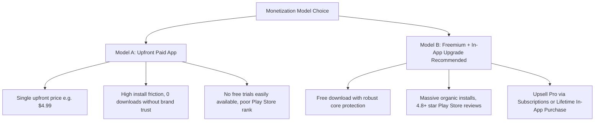
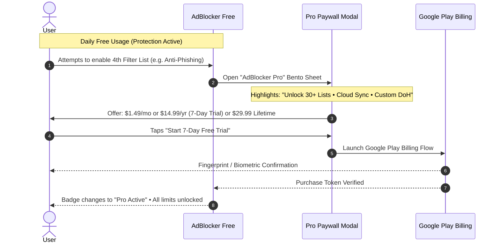
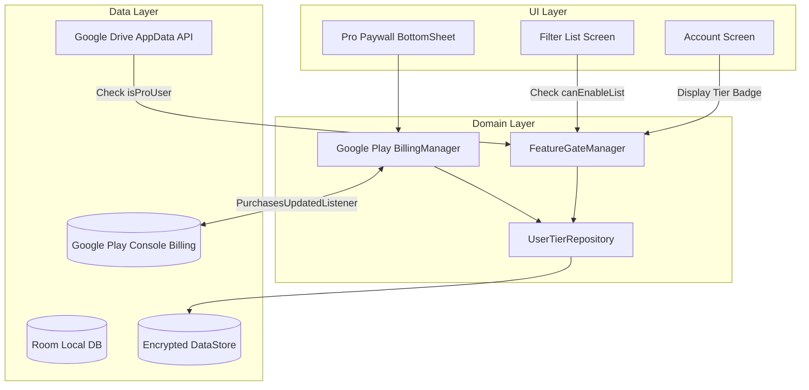
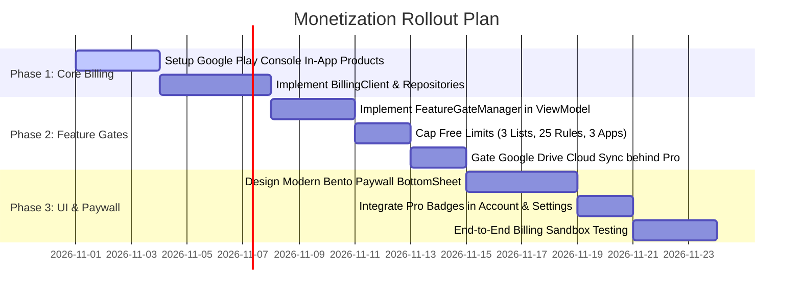

# AdBlocker — Product Monetization Strategy & Feature Tiering Architecture

> **Document Version:** 1.0.0  
> **Target Platform:** Google Play Store (Android)  
> **App:** AdBlocker (Local VPN DNS Filter & Privacy Shield)

---

## 1. Executive Summary & Recommended Business Model

When monetizing an Android utility — especially a cybersecurity and DNS ad-blocking tool — choosing the right commercial model determines your user acquisition volume, conversion rate, and Lifetime Value (LTV).

### The Two Strategic Options



### 💡 Recommendation: Freemium with "Pro" In-App Purchase (IAP) & Lifetime Option

1. **Why Direct Paid (Upfront) Struggles on Android:**
   - Ad blockers require user trust before purchase. Users want to see if the local VPN works with their specific banking apps, streaming apps, and ISP without breaking connectivity.
   - Upfront paid apps receive **80% to 90% fewer organic impressions** on the Google Play Store search algorithm compared to free apps with active daily users.
2. **Why Freemium Wins (The AdGuard / Blokada / 1Blocker Blueprint):**
   - **Top-of-Funnel Viral Growth:** The free tier blocks common ads and trackers effortlessly, generating glowing user reviews and word-of-mouth recommendations.
   - **Predictable Recurring Revenue:** Monthly and annual subscriptions create stable monthly recurring revenue (MRR).
   - **Lifetime License Anchor:** Offering a one-time "Lifetime Pro" option captures high-intent Android power users who refuse recurring subscriptions, providing instant upfront cash flow.

---

## 2. Comprehensive Feature Matrix: Free vs. Pro

| Feature Category | Feature Description | Free Tier (Standard) | Pro Tier (Premium) | Monetization Psychology / Value Justification |
| :--- | :--- | :---: | :---: | :--- |
| **Core VPN Shield** | Local VPN DNS tunnel & loopback proxy | ✅ Full Speed | ✅ Full Speed (Optimized) | Essential utility must never be degraded; keeps trust high. |
| **System-Wide Blocking** | Block ads across apps, games & browsers | ✅ Standard | ✅ Advanced Engine | Free tier proves value immediately across all apps. |
| **Filter Subscriptions** | Built-in filter lists (AdGuard, StevenBlack, etc.) | ⚠️ Up to **3 Active Lists** | 🌟 **Unlimited Lists (30+)** | Power users needing anti-malware, crypto, adult & regional lists upgrade. |
| **Filter Auto-Update** | Periodic background list synchronization | ⚠️ Manual only (or weekly) | 🌟 **Automatic Daily / Real-Time** | Pro users receive zero-day malicious domain definitions automatically. |
| **Custom Filter Rules** | User-defined whitelist & blacklist domains | ⚠️ Max **25 Custom Rules** | 🌟 **Unlimited Custom Rules** | Developers & power users manage complex whitelists/blacklists. |
| **Custom Wildcards & Regex** | Advanced domain pattern blocking (`||*.telemetry.com^`) | ❌ Standard exact match only | 🌟 **Full Regex & Wildcard Engine** | Advanced filtering syntax reserved for Pro. |
| **Upstream DNS Providers** | Standard upstream DNS resolvers | ✅ Standard (Google, Cloudflare, System) | 🌟 **All + Mullvad, Quad9, AdGuard Family** | Privacy purists get privacy-first audited upstreams. |
| **Encrypted DNS (DoH / DoT)** | Custom DNS-over-HTTPS & DNS-over-TLS endpoints | ❌ Standard Port 53 / Presets | 🌟 **Custom DoH/DoT URLs (NextDNS, Pi-hole)** | NextDNS & Pi-hole enthusiasts will happily pay for custom DoH endpoints. |
| **Per-App Network Firewall** | Bypass or isolate specific apps from VPN | ⚠️ Max **3 Bypassed Apps** | 🌟 **Unlimited Per-App Routing & Kill-Switch** | Users with work profiles, banking apps, and gaming tunnels need full control. |
| **Real-Time DNS Logs** | Live query stream & inspection | ⚠️ Last **1 Hour / 100 queries** | 🌟 **Unlimited Live Stream + Search & Filter** | Live debugging and audit logging is a premium developer/privacy feature. |
| **Privacy Analytics** | Metrics on blocked ads, trackers & saved data | ⚠️ Basic 24h Summary | 🌟 **30-Day Historical Trends & Visual Breakdowns** | Graphs, top offending apps, and data-saved metrics create high perceived value. |
| **Log Export & Auditing** | Export DNS query history as CSV/JSON | ❌ Not available | 🌟 **1-Click CSV / JSON Export** | Essential for IT admins, security researchers, and privacy geeks. |
| **Google Drive Cloud Sync** | Cloud backup & multi-device sync | ❌ Local device storage only | 🌟 **Automatic Google Drive Sync & Backup** | Seamless multi-phone/tablet synchronization is the #1 paid conversion trigger. |
| **Ad-Free In-App Browser** | Fast built-in privacy browser | ✅ Basic popup blocking | 🌟 **Cosmetic Element Hiding & Cookie Dismissal** | Removes annoying "Accept Cookies" banners automatically. |
| **Scheduled Protection** | Auto-activate VPN on public Wi-Fi / schedule | ❌ Manual toggle only | 🌟 **Wi-Fi Automation & Night Quiet Hours** | "Set it and forget it" convenience drives sticky retention. |
| **App Icon & Themes** | Custom app icons & Cyber Dark aesthetics | ✅ Standard Cyan theme | 🌟 **Exclusive Pro Icons & Obsidian Themes** | Low development cost, high emotional appeal for personalization. |
| **Customer Support** | Issue resolution & domain unblocking requests | Community GitHub | 🌟 **Priority In-App Fast-Track Support** | Direct channel to report broken site rules. |

---

## 3. High-Conversion User Journeys & Natural Chokepoints

To maximize conversion without irritating free users, enforce paywalls at **natural intent chokepoints**:



### Top 4 Conversion Triggers

1. **The "Google Drive Backup" Trigger (Settings / Account):**
   - User customizes their filters and sees "Backup to Google Drive".
   - Tapping "Backup Now" or "Enable Cloud Sync" prompts:  
     *“Keep your custom rules & filters synchronized across all your devices with AdBlocker Pro.”*
2. **The "Custom DoH / NextDNS" Trigger (Settings Screen):**
   - User wants to paste their personal NextDNS or Pi-hole URL.
   - The custom input field displays a subtle glowing `[ PRO ]` badge.
3. **The "4th Filter Subscription" Trigger (Filters Screen):**
   - Free users can freely enable 3 core lists (e.g., AdGuard Base, Tracking, EasyList).
   - Tapping a 4th list (e.g. Malware Domains or Social Widgets) opens a bottom sheet:  
     *“You've unlocked 3 free filter lists. Upgrade to Pro for unlimited multi-category defense.”*
4. **The "App Bypass Limit" Trigger (Apps Screen):**
   - Allowing 3 apps to bypass the VPN covers 90% of basic users (e.g. Bank app + Android Auto). Power users who want to whitelist 10+ apps trigger the Pro unlock.

---

## 4. Recommended Pricing Architecture

Based on Google Play Store benchmarks for security & utility applications in tier-1 and global markets:

```
┌────────────────────────────────────────────────────────────────────────┐
│                        PRICING TIERS                                   │
├─────────────────────┬──────────────────────┬───────────────────────────┤
│ Tier                │ Price (USD)          │ Strategy                  │
├─────────────────────┼──────────────────────┼───────────────────────────┤
│ 1. Monthly Pro      │ $1.99 / month        │ Low impulse-entry point   │
│ 2. Annual Pro       │ $14.99 / year        │ ⭐ BEST VALUE (Anchor)    │
│    (with 7-Day Trial)│ (~$1.25 / month)     │ (Includes 7-day trial)    │
│ 3. Lifetime License │ $29.99 (one-time)    │ Power-user cash-flow shot │
└─────────────────────┴──────────────────────┴───────────────────────────┘
```

> [!TIP]
> **Regional Purchasing Power Parity (PPP):**  
> Enable Google Play Console's automatic localized pricing or apply manual discounts for emerging markets (e.g. India, Brazil, Southeast Asia) where a ₹499/year or \$4.99/year price point increases overall revenue by 300%.

---

## 5. Technical Architecture & Implementation Blueprint

### 5.1 Architecture Diagram



### 5.2 Data Model: User Tiers (`UserTier.kt`)

```kotlin
enum class UserTier(val title: String, val isPro: Boolean) {
    FREE("Free Tier", isPro = false),
    PRO_MONTHLY("Pro Monthly", isPro = true),
    PRO_ANNUAL("Pro Annual", isPro = true),
    PRO_LIFETIME("Pro Lifetime", isPro = true);

    companion object {
        fun fromSku(sku: String?): UserTier = when (sku) {
            "adblocker_pro_monthly" -> PRO_MONTHLY
            "adblocker_pro_annual" -> PRO_ANNUAL
            "adblocker_pro_lifetime" -> PRO_LIFETIME
            else -> FREE
        }
    }
}
```

### 5.3 Feature Gating Interface (`FeatureGateManager.kt`)

```kotlin
class FeatureGateManager(
    private val userTierRepo: UserTierRepository
) {
    val isPro: StateFlow<Boolean> = userTierRepo.isProState

    // Rules & Limits
    val maxActiveFilterLists: Int get() = if (isPro.value) Int.MAX_VALUE else 3
    val maxCustomRules: Int get() = if (isPro.value) Int.MAX_VALUE else 25
    val maxBypassedApps: Int get() = if (isPro.value) Int.MAX_VALUE else 3
    
    // Capability Flags
    val canUseCustomDoH: Boolean get() = isPro.value
    val canUseCloudSync: Boolean get() = isPro.value
    val canExportLogs: Boolean get() = isPro.value
    val canUseAutoDailyUpdates: Boolean get() = isPro.value
}
```

### 5.4 Google Play Dependencies to Add

Add the following to [`app/build.gradle.kts`](file:///c:/Projects/AndroidStudioProjects/AdBlocker/app/build.gradle.kts):

```kotlin
dependencies {
    // Official Google Play Billing KTX
    implementation("com.android.billingclient:billing-ktx:7.0.0")
}
```

---

## 6. Implementation Milestones



---

## 7. Summary & Next Steps

By adopting this **Freemium + Pro** architecture:
1. **Free users** stay delighted with rock-solid, zero-ad protection across their entire phone, driving organic downloads and 5-star ratings.
2. **Power users, privacy enthusiasts, and multi-device owners** are smoothly guided toward the Pro tier through natural limits (Cloud Sync, unlimited filter lists, custom DoH endpoints).
3. You build a resilient, recurring revenue business on Google Play with both subscription MRR and lifetime cash generation.
